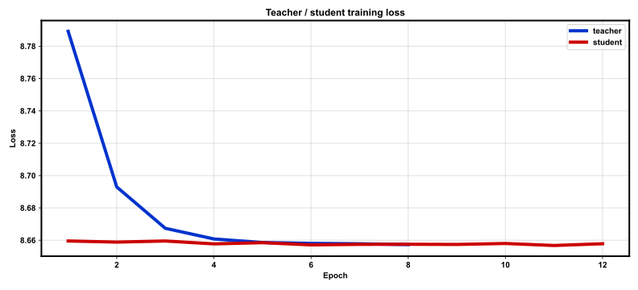
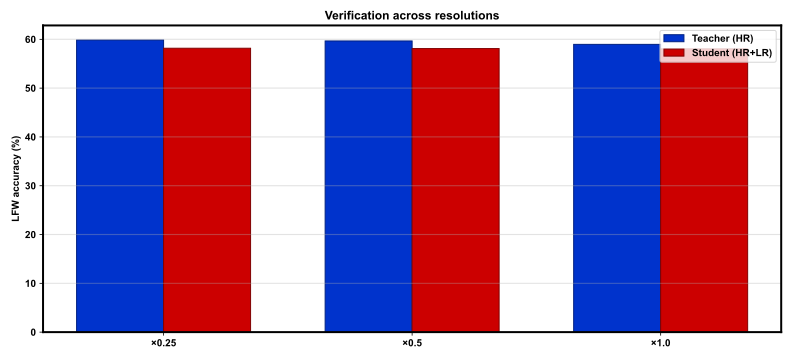

# REPORT: Resolution-Invariant Distillation — full

**Protocol:** `full`  
**Package:** `rifr`  

## Summary (LFW)

| Scale | Teacher Acc | Teacher EER | Student Acc | Student EER |
|-------|-------------|-------------|-------------|-------------|
| scale_1.0 | 58.97% | 41.03% | 58.05% | 41.95% |
| scale_0.5 | 59.67% | 40.33% | 58.10% | 41.90% |
| scale_0.25 | 59.85% | 40.15% | 58.17% | 41.83% |

## Training

- Teacher epochs: 8
- Student epochs: 12
- Train images: 141610
- Identities: 7124
- LR scales: [1.0, 0.5, 0.25]
- Elapsed: 1658.38 s
- Checkpoint: `outputs/checkpoints/full/last.pt`

## Figures

### `train_loss.svg`



### `lfw_by_scale.svg`



## Reproduce

```bash
bash scripts/smoke.sh
bash scripts/train_full.sh
```

## Notes

- CelebA substitutes MegaFace/FaceScrub for HR teacher pretraining (DEVIATIONS.md).
- Synthetic LR via downsample→upsample; TinyFace/SCFace not available.
